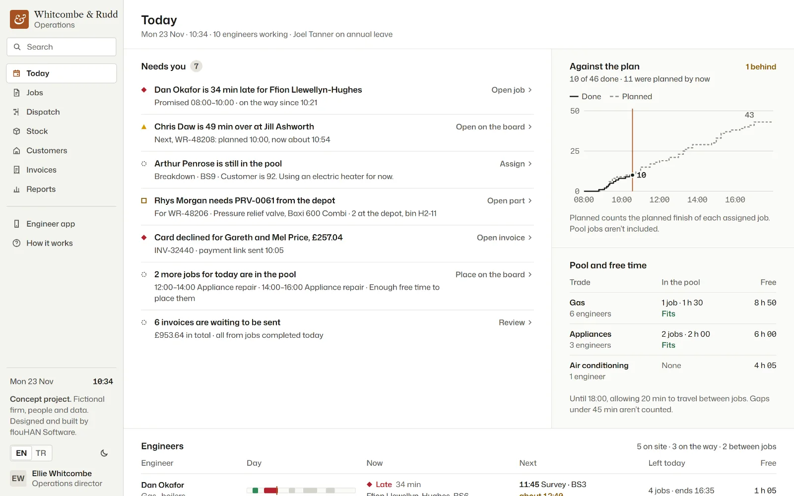
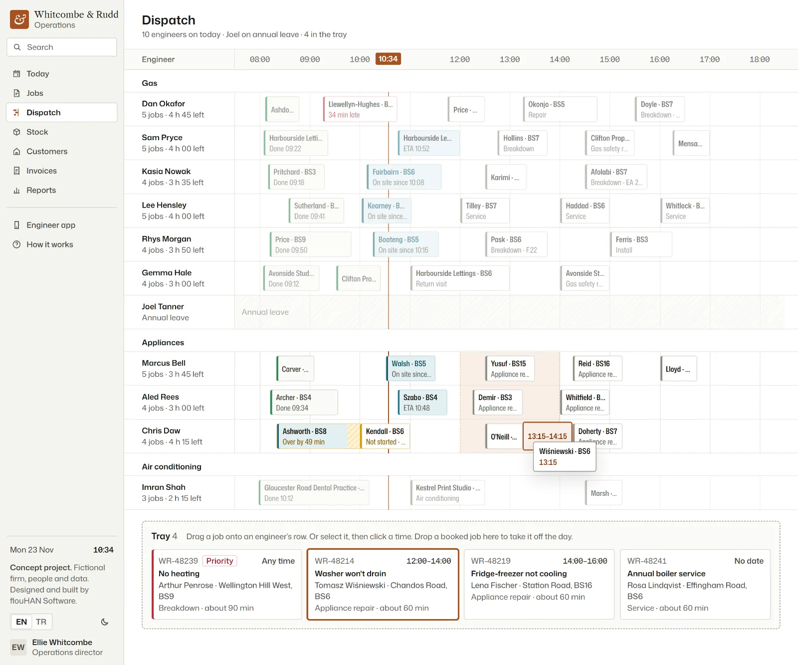
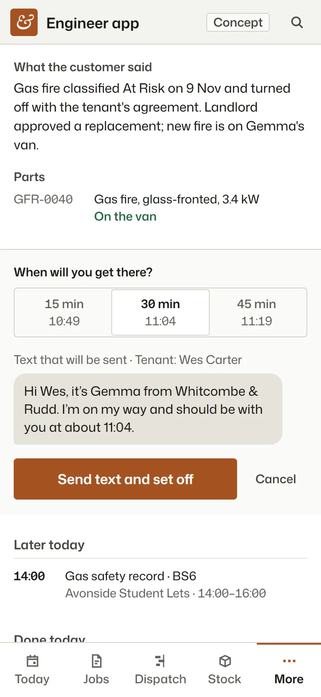
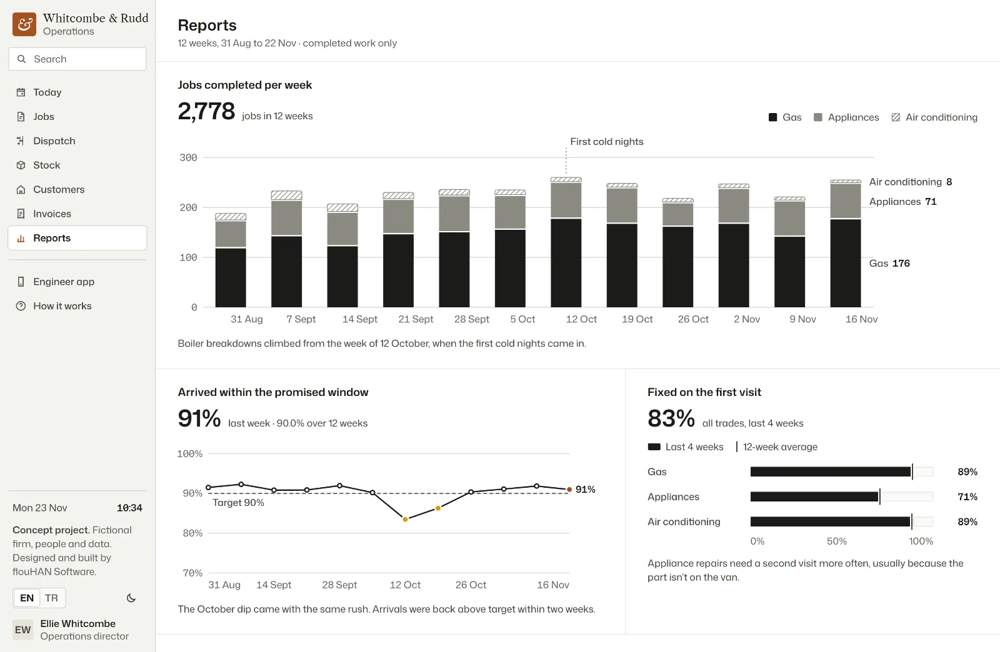

# Whitcombe & Rudd · operations dashboard

A concept web app by [flouHAN Software](https://flouhan.com): the office system and the engineers' phone app for a firm that services boilers, appliances and air conditioning. The firm, its people and its data are made up.

- **Live demo:** https://flouhan.com/demo/operasyon-paneli/
- **Case study, with a one-minute walkthrough:** https://flouhan.com/en/work/operations-dashboard/

[](https://flouhan.com/en/work/operations-dashboard/)

## What it does

It is 10:34 on a Monday and the clock keeps running. Ten engineers are out (the eleventh is on leave), some jobs are running late, one has overrun, and a few are still waiting in the tray.

- **Today** lists what needs someone right now. Each line opens the screen where it gets sorted.
- **Dispatch** is a board of each engineer's day. Dragging a job across it shades the arrival window promised to the customer; drop it outside that window and the board offers to text the customer a new time.
- **Engineer app** is built for one hand on a phone: set off (the tenant's text is shown before it goes), arrive, finish with a note. Finishing a job drafts its invoice and takes the parts used off the van stock.
- **Jobs, Stock, Customers and Invoices** cover the rest of the office's day.
- **Reports** show the last 12 weeks in ink-toned charts, with a table per engineer.

There are two kinds of account. The office sees every screen. An engineer sees only their own day, and office routes send them back to it. The demo accounts have no password: the sign-in screen just picks a person.

The interface is in English and Turkish, with a light and a dark theme. A short guide opens on the first visit.



## Live session

"Try it on your phone" starts a session and shows a QR code. The phone opens as Gemma Hale, one of the engineers, and from then on both devices work on the same data.

- Each session is one Cloudflare Durable Object with SQLite storage ([`server/ops-room.js`](server/ops-room.js)).
- Devices connect over WebSocket to `/api/ops/rooms/:id`. The first device seeds the room with its data and its demo clock. After that only changed records travel, keyed by id, and the room passes them on to everyone else.
- Limits: same-origin connections only, 300 KB per message, 40 messages per 10 seconds per device, 12 devices per room, three known collections. A room nobody has touched for 24 hours deletes itself on an alarm.
- On the client: [`src/lib/live.ts`](src/lib/live.ts) (connection, reconnect with backoff, diff and apply) and [`src/data/store.tsx`](src/data/store.tsx).

The demo says what each device stands for and what to check, and ticks each check off when the change arrives from the other device.



## Running it

Node 22 or newer.

```sh
npm install
npm run dev        # http://localhost:5190 (no live session)
npm run server     # build, then app and live session on http://localhost:8787
npm run deploy     # to your own Cloudflare account
```

## Checks

```sh
npm run check            # every screen at 1440, 1024 and 375 px in both languages,
                         # axe-core against WCAG 2.1 AA, sign-in and a tapped engineer flow
npm run live-check       # two browsers, office and phone, through the live-session checks
                         # (needs npm run server)
npm run video -- en      # records the walkthrough from the running demo; video-phone for the phone cut
```

Screenshots, reports and videos are written to `output/`.

## Layout

```
src/
  App.tsx          office and engineer shells, role guard
  components/      shell, guide, sign-in and account, live session dialog
  data/            seed data (loaded as its own chunk), store, derived figures
  lib/             i18n, routing, demo clock, live session client, accounts
  pages/           one folder per screen
server/            Cloudflare Worker and the Durable Object
scripts/           Playwright checks and video recording
```

Comments in the source are written in Turkish.



## Licence

© 2026 flouHAN Software. The code is published to be read and reviewed. It is not licensed for reuse.
